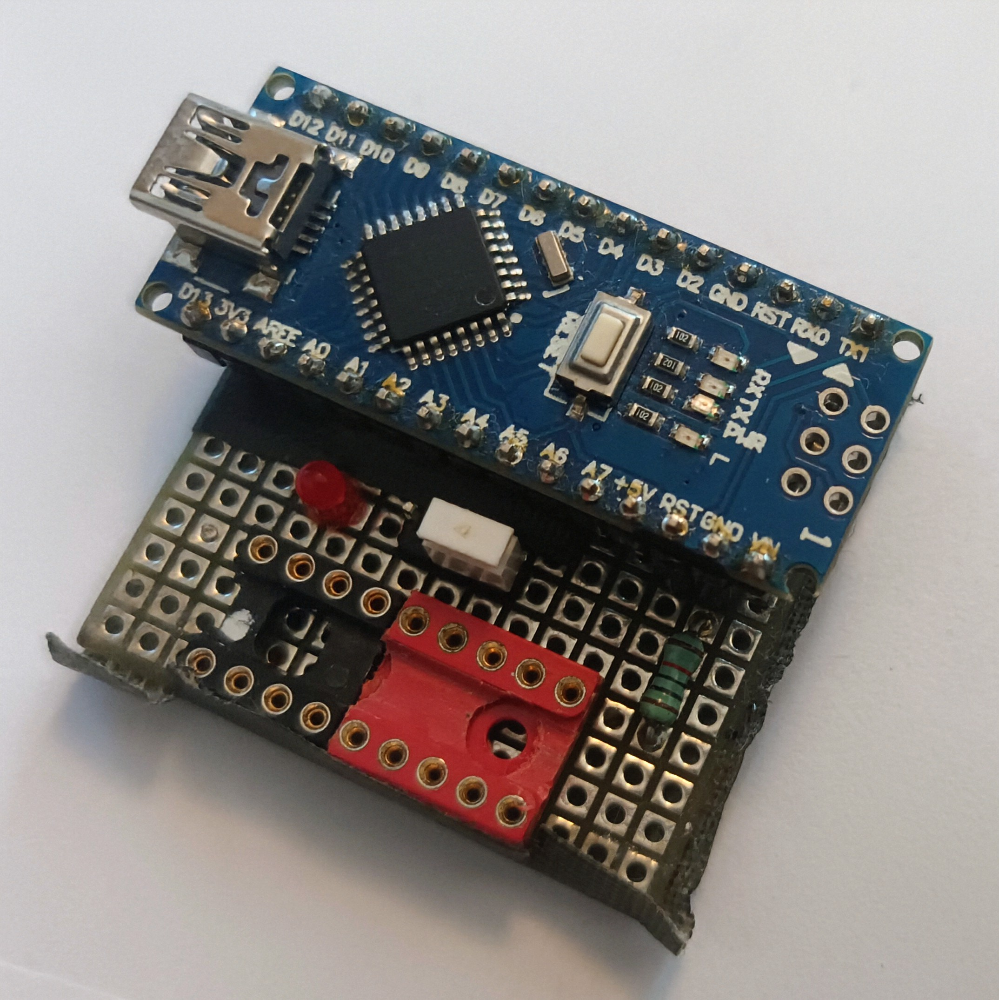
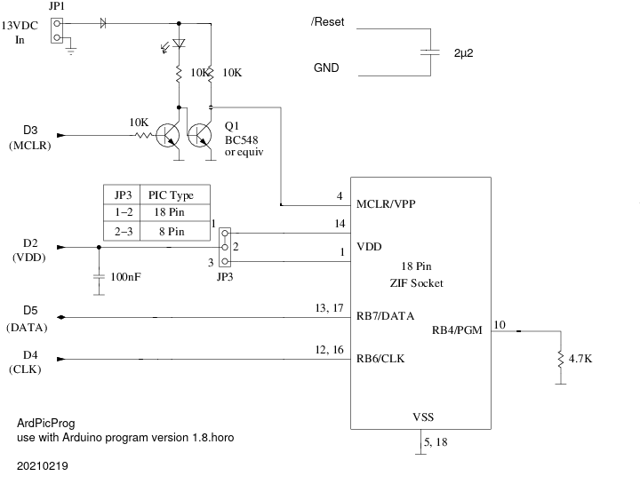

# Arduino-based PIC programmer

This distribution contains an Arduino-based solution for programming
baseline and mid-range PIC microcontrollers from Microchip Technology Inc,
such as the PIC12F675, PIC16F628A and friends. The solution has three parts:

## Circuit to interface to the PIC and provide the HV programming voltage.

  

  

## [ProgramPIC](ProgramPic)
The Firmware loaded into an Arduino Nano interfaces directly with the PIC.
This program implements a simple serial protocol for interfacing with the host.
New PIC devices and programming parameter can be added easily.

## [ardpicprog](ArdPicProg)
Drop-in replacement for [picprog](http://hyvatti.iki.fi/~jaakko/pic/picprog.html)
that implements the serial protocol and controls the PIC programming process
on the computer side. Tested under Linux, should also work on Windows.

```
Usage: ardpicprog --quiet -q --verbose -v --help -h
    --device DEVTYPE -d DEVTYPE --pic-serial-port PORT -p PORT
    --input-hexfile INPUT -i INPUT --output-hexfile OUTPUT -o OUTPUT
    --ihx8m --ihx16 --ihx32 --cc-hexfile CCFILE -c CCFILE --skip-ones
    --erase --burn --force-calibration --list-devices --detect --speed SPEED

Supported devices:
pic12f629*, pic12f675*, pic12f683*, pic16f630*, pic16f676*, pic16f84,
pic16f84a*, pic16f87*, pic16f88*, pic16f627*, pic16f627a*, pic16f628*,
pic16f628a*, pic16f648a*, pic16f684*, pic16f688*, pic16f690*, pic16f877*,
pic16f877a*, pic16f882*, pic16f883*, pic16f884*, pic16f886*, pic16f887*
* = autodetected
```

## [QPICkit](https://github.com/Ho-Ro/QPICkit)
A simple GUI for these CLIs:

- `ardpicprog`
- [pk2cmd](https://github.com/cjacker/pk2cmd-minus)
the CLI for use with the original
[PICkit™ 2](https://www.microchip.com/en-us/development-tool/pg164120),
[PICkit™ 3](https://www.microchip.com/en-us/development-tool/pg164130)
and compatible programmer devices
- [PICkit1](https://www.microchip.com/en-us/development-tool/dv164101)
the CLI for the
[PICkit™ 1](https://www.microchip.com/en-us/development-tool/dv164101)
FLASH Starter Kit

